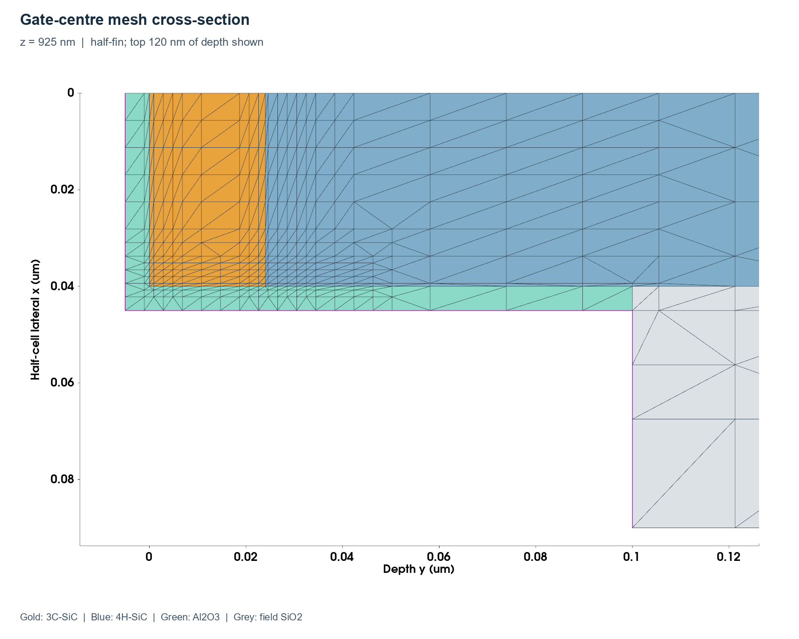

# 3C/4H-SiC Tri-Gate HEMT and TiS₂ Heterostructure Contact Study

This Sentaurus TCAD study compares a proposed three-dimensional tri-gate MIS HEMT with a planar MIS control using a 3C/4H-SiC polarization heterostructure. The transport model was fitted to published measurements of a planar n-channel Schottky-gate HEMT. The tri-gate and the planar MIS control both extrapolate that fit to an oxide-gated geometry.



## Results

- The planar calibration gives a 2.01 mA/mm RMS error across five digitized output curves.
- At a 250 nm gate length, simulated drain-induced barrier lowering falls from 71 to 5 mV/V. The threshold is extracted at 1 mA/mm, using drain biases of 0.5 and 7 V.
- At the same length, with 7 V drain bias and 2 V gate overdrive, the AC extraction gives 15.42 GHz fT and 17.61 GHz fmax for the tri-gate, compared with 23.19 GHz and 26.12 GHz for the planar control. The tri-gate has higher gate capacitance per device width at this operating point.
- The simulations use ideal dielectric interfaces for the baseline comparison. Tri-gate on-current per fin width and per layout footprint use different normalizations. The RF values are simulated small-signal crossings at the modeled terminals.

## Files

| Path | Contents |
| --- | --- |
| `calibration/` | Planar fit decks, digitized measurement points, simulated output curves, and the fit analysis |
| `phaseN01/` | 250 nm planar and tri-gate DC decks, transfer curves, case definitions, and extracted metrics |
| `rf/` | 250 nm AC decks, terminal admittance matrices, and extracted RF metrics |
| `tis2/` | TiS₂ monolayer parameter file, contact benchmark, and resistance sweep decks |
| `figures/` | Sentaurus Visual mesh, band diagram, and electron-density views |

## Reproduce the DC and calibration analysis

Use Python 3 with NumPy. From the repository root:

```bash
python -m pip install -r requirements.txt
python analyze_N01.py
cd calibration
python analyze_nch.py fitC
```

The scripts read the included Sentaurus text exports and regenerate their respective metrics JSON files.

## Rerun the device simulations

The decks were prepared for Synopsys Sentaurus Y-2026.03. A licensed local installation and its standard material library are required. Use a working copy. For each DC case, run `sde -e -l sde.cmd` from its case directory, then run `sdevice lin_des.cmd`. The planar calibration uses `sdevice fam_des.cmd` after meshing. For an RF deck, copy `dev_msh.tdr` from the corresponding high-drain DC case into its own directory before running `sdevice ac_des.cmd`. For example, `tri_L0250_ov2` uses the mesh from `tri_L0250_hi`.

## TiS₂ model and contact sweep

The 3C/4H-SiC interface is the active heterostructure in the HEMT. The TiS₂ contact study uses effective source and drain resistances of 7.8, 2, and 0.5 Ω·mm in sensitivity decks. The 7.8 Ω·mm setting approximates a value inferred from a published TiS₂/MoS₂ contact benchmark ([Yoon et al.](https://doi.org/10.1021/acsami.3c18982)). The lower values are sensitivity points. TiS₂/SiC contact resistance remains unverified.

The included TiS2.par models an ideal semiconducting TiS₂ monolayer at 300 K for exploratory calculations. The HEMT decks use lumped resistance for the contact study. The parameter file is independent of those deck inputs.

## Measurement reference

H. Sazawa et al., “SiC-based high electron mobility transistor,” *Applied Physics Letters*, vol. 124, 120601, 2024. The calibration CSV contains numerical points digitized from Fig. 4 for comparison with the simulated output curves.
