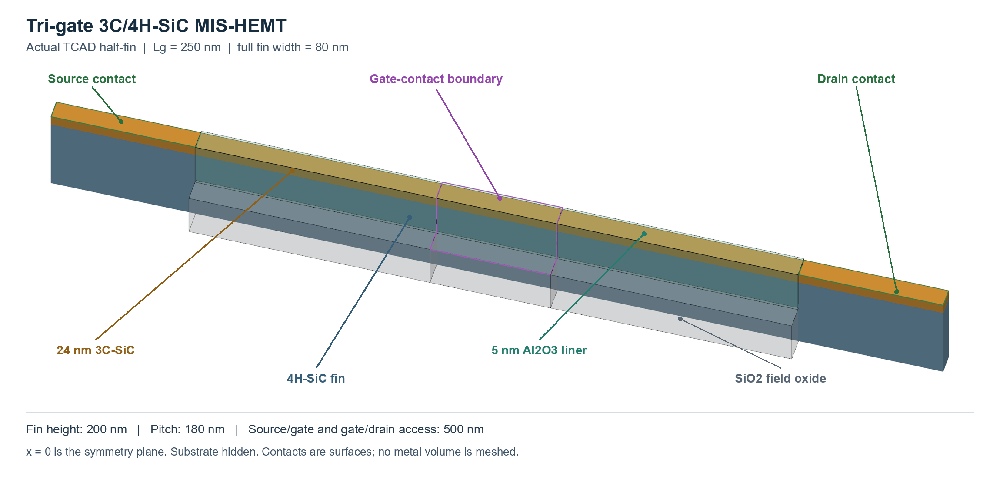
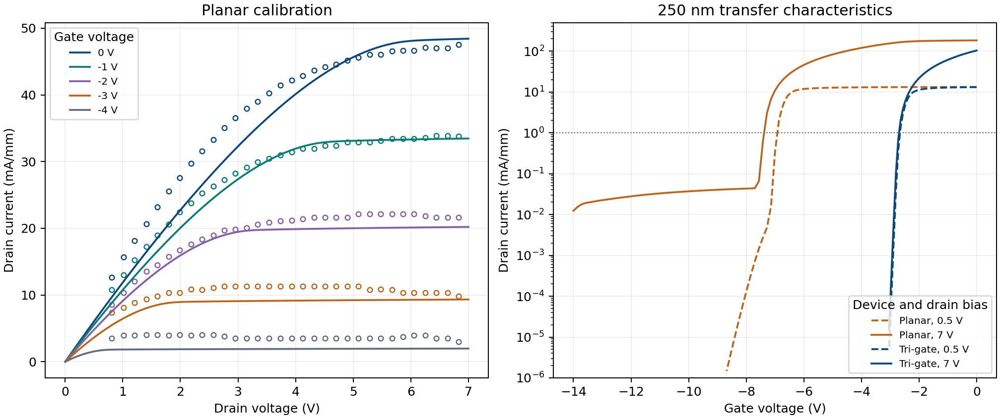

# TiS₂ Contact Heterostructure Study for a 3C/4H-SiC Tri-Gate HEMT

This project asks two device-design questions. How much does a tri-gate improve electrostatic control in a short-channel 3C/4H-SiC HEMT? How sensitive is the resulting device to source and drain contact resistance, and what would it take to evaluate TiS₂ as a contact interlayer?

A planar Sentaurus model fitted to published n-channel HEMT measurements provides the transport baseline. The 250 nm planar and tri-gate MIS variants share the same material model and nominal contact resistance. The follow-on TiS₂ work consists of a separate monolayer parameter file and HEMT decks that vary lumped contact resistance. An explicit TiS₂/SiC interface is proposed below.

## 3D device structure



*Sentaurus Visual rendering of the simulated half-fin. Reflecting it across the symmetry plane gives the full fin. The gate is assigned to model boundary faces, with the metal volume outside the simulated domain. The substrate is hidden in this view.*

| Feature | Model geometry |
| --- | ---: |
| Gate length | 250 nm |
| Full fin width / simulated half-width | 80 / 40 nm |
| Fin height / pitch | 200 / 180 nm |
| 3C-SiC layer on 4H-SiC | 24 nm |
| Al₂O₃ gate liner | 5 nm |
| SiO₂ field-oxide depth | 100 nm |
| Source-side / drain-side gate access length | 500 / 500 nm |

The 3C/4H interface forms the active polarization heterostructure. The n-channel model represents the polarization discontinuity with a positive sheet charge of 1.48 × 10¹³ cm⁻². The oxide-lined gate controls the fin from its top and sidewalls. The [3D SDE source](phaseN01/tri_L0250_hi/sde.cmd) defines the regions, symmetry, contact faces and mesh refinement and generates the 3D Sentaurus mesh locally.

[Gate-centre mesh](figures/mesh_detail_labelled.png) · [Vertical band profile](figures/bands_vertical_labelled.png) · [On-state electron density](figures/density_on_detail_labelled.png)

## Calibration and results

The [planar calibration](calibration/fitC/hemt) uses five digitized output curves from [Sazawa et al.](https://doi.org/10.1063/5.0202925). The fit gives **2.01 mA/mm RMS error**. At VGS = 0 V and VDS = 7 V, the model gives **48.42 mA/mm** and the digitized reference gives **47.56 mA/mm**. The fit uses effective under-gate mobility and an effective Schottky work function. Transferring the transport settings to the MIS designs is an extrapolation.

| Simulated quantity at 250 nm | Planar MIS | Tri-gate MIS |
| --- | ---: | ---: |
| DIBL (mV/V) | 71 | 5 |
| Extracted subthreshold swing at VDS = 7 V (mV/dec) | 178 | 60 |
| Gate capacitance per device width at VDS = 7 V and 2 V overdrive (fF/µm) | 0.320 | 0.538 |
| Current-gain cutoff frequency at the same bias (GHz) | 23.19 | 15.42 |
| Maximum oscillation frequency at the same bias (GHz) | 26.12 | 17.61 |

Threshold is defined at 1 mA/mm. DIBL uses drain biases of 0.5 and 7 V. The minimum swing is extracted above the stated current floor in the analysis script. The high-drain planar curve has residual off-state leakage, so its swing is indicative. Tri-gate current density uses fin width unless explicitly normalized by layout footprint. The comparison uses ideal dielectric interfaces. The small-signal results show an electrostatic improvement alongside a capacitance and frequency penalty at the reported bias.

[DC metrics](phaseN01/METRICS_N01.json) · [RF bias points and results](rf/RF_RESULTS.csv)



*Left: simulated output curves (lines) and sampled digitized measurements (open markers). Right: transfer curves at 0.5 and 7 V, with the 1 mA/mm threshold criterion marked. Currents below the extraction floor are omitted.*

### DC operating points

| Device | Drain bias (V) | Threshold (V) | Minimum swing (mV/dec) | Current at 2 V overdrive (mA/mm of device width) |
| --- | ---: | ---: | ---: | ---: |
| Planar | 0.5 | −6.918 | 151 | 12.75 |
| Planar | 7.0 | −7.378 | 178 | 68.62 |
| Tri-gate | 0.5 | −2.659 | 60 | 12.94 |
| Tri-gate | 7.0 | −2.694 | 60 | 73.87 |
| Tri-gate, fine mesh | 7.0 | −2.678 | 60 | 73.39 |

The high-drain tri-gate current changes by about 0.7% under mesh refinement. Normalized to the full 180 nm fin pitch, its nominal current at 2 V overdrive is 32.83 mA/mm of footprint.

### RF bias sweep at 7 V drain bias

| Device | Overdrive (V) | Current (mA/mm) | Transconductance (mS/mm) | Gate capacitance (fF/µm) | Current-gain cutoff (GHz) | Maximum oscillation frequency (GHz) |
| --- | ---: | ---: | ---: | ---: | ---: | ---: |
| Planar | 0.5 | 14.83 | 32.78 | 0.303 | 21.81 | 27.77 |
| Planar | 1 | 32.05 | 35.59 | 0.305 | 23.46 | 28.14 |
| Planar | 2 | 68.62 | 37.10 | 0.320 | 23.19 | 26.12 |
| Tri-gate | 0.5 | 14.90 | 34.10 | 0.557 | 12.00 | 15.69 |
| Tri-gate | 1 | 33.25 | 38.60 | 0.544 | 14.01 | 16.93 |
| Tri-gate | 2 | 73.87 | 42.08 | 0.538 | 15.42 | 17.61 |

The current-gain cutoff uses the unity crossing of the short-circuit current gain. The maximum oscillation frequency uses the unity crossing of Mason’s unilateral power gain. The terminal matrices and crossing diagnostics are included with the RF data.

## Decks and run sequence

The decks were prepared for **Sentaurus Y-2026.03**. Rerunning them requires a licensed installation and its standard material library. The included text exports can be analyzed with Python and NumPy.

| File | What it controls |
| --- | --- |
| [sde.cmd](phaseN01/tri_L0250_hi/sde.cmd) | Builds the half-fin, dielectric regions, doping, gate and terminal faces, and mesh. It refines around the 3C/4H interface, sidewall and gate edges. |
| [materials.par](phaseN01/tri_L0250_hi/materials.par) | Defines 3C-SiC material overrides, the 4H-SiC parameter insert, under-gate mobility, thermionic interface formulation and Al₂O₃ permittivity. |
| [lin_des.cmd](phaseN01/tri_L0250_hi/lin_des.cmd) | Sets the polarization sheet charge and terminal conditions, initializes Poisson and electron transport, ramps drain voltage, then sweeps gate voltage. It exports equilibrium, on-state and off-state fields and a transfer curve. |
| [fam_des.cmd](calibration/fitC/hemt/fam_des.cmd) | Runs the planar calibration output sweeps at multiple gate voltages. |
| [ac_des.cmd](rf/decks/tri_L0250_ov2/ac_des.cmd) | Biases the DC device and extracts the gate, drain and source admittance matrix at 61 points from 1 MHz to 1 THz. RF cases use matched threshold-relative overdrive. |

1. Run `sde -e -l sde.cmd` from a case directory to generate `dev_msh.tdr`. Open that file in Sentaurus Visual to inspect the 3D structure interactively.
2. Run `sdevice lin_des.cmd` for each low- and high-drain transfer case, or `sdevice fam_des.cmd` for the calibration.
3. For an RF case, copy `dev_msh.tdr` from the matching high-drain DC directory into the AC case directory. For example, `tri_L0250_ov2` uses the mesh from `tri_L0250_hi`. Run `sdevice ac_des.cmd`.

To reproduce the DC metrics and calibration fit from the included data, run from the repository root.

```bash
python -m pip install -r requirements.txt
python analyze_N01.py
python plot_dc_results.py
cd calibration
python analyze_nch.py fitC
```

## TiS₂ parameters and the proposed TiS₂/SiC interface

[TiS2.par](tis2/TiS2.par) describes an **ideal monolayer at 300 K** for electrostatic and low-field transport tests. Its effective slab thickness is 0.505 nm. The file specifies relative electronic permittivities of 19.39 in-plane and 8.42 out-of-plane, a 0.410 eV band gap, a 5.621 eV electron affinity, and constant electron and hole mobilities of 10 and 530 cm²/(V·s). The density-of-states parameters approximate the sheet density over the energy range documented in the file. The dielectric tensor must be aligned with the layer normal in a deck that uses it. These settings describe a monolayer candidate and do not establish the properties of a deposited semimetallic contact film.

The [contact sweep](tis2/contact-sweep) varies the effective source and drain resistance at 7.8, 2 and 0.5 Ω·mm. The 7.8 Ω·mm point is an approximate per-contact value inferred from a published [TiS₂/MoS₂ contact study](https://doi.org/10.1021/acsami.3c18982). The [benchmark record](tis2/TiS2_contact_role.json) documents its extraction assumptions. A TiS₂/SiC contact measurement remains an open requirement.

### Proposed construction and validation

1. **Build a contact test structure first.** Prepare exposed 3C-SiC contact windows on a 3C/4H stack. Compare a reference metal contact against a patterned TiS₂ interlayer capped with metal. Evaluate deposition or transfer and encapsulation on test coupons before incorporating the interlayer into the fin process. Keep the tri-gate oxide insulated from the contact stack.
2. **Characterize the interface.** Check film phase and stoichiometry and inspect the buried interface. Extract contact resistance with a transfer-length structure across bias and temperature. Compare contact stacks on the same SiC surface preparation and access geometry.
3. **Build the explicit model.** Use atomistic calculations or interface measurements to constrain band alignment, charge transfer and the effective injection barrier. In Sentaurus, place the TiS₂ region at the source and drain windows while keeping the 3C/4H channel and gate geometry fixed. For a semimetallic film, use film-specific transport or a calibrated interface boundary. Use the monolayer file for a separate monolayer sensitivity case.
4. **Test the device-level trade-off.** Fit the contact model to the test structures, then compare the reference and TiS₂-contact HEMTs at matched drain bias and overdrive. Re-extract current, transconductance, DIBL and RF metrics to check whether any reduction in contact loss survives the added parasitics.

## References

1. H. Sazawa et al., “SiC-based high electron mobility transistor,” *Applied Physics Letters*, vol. 124, 120601, 2024. [DOI](https://doi.org/10.1063/5.0202925)
2. H. Yoon et al., “Investigation on Contact Properties of 2D van der Waals Semimetallic 1T-TiS₂/MoS₂ Heterojunctions,” *ACS Applied Materials & Interfaces*, 2024. [DOI](https://doi.org/10.1021/acsami.3c18982)
